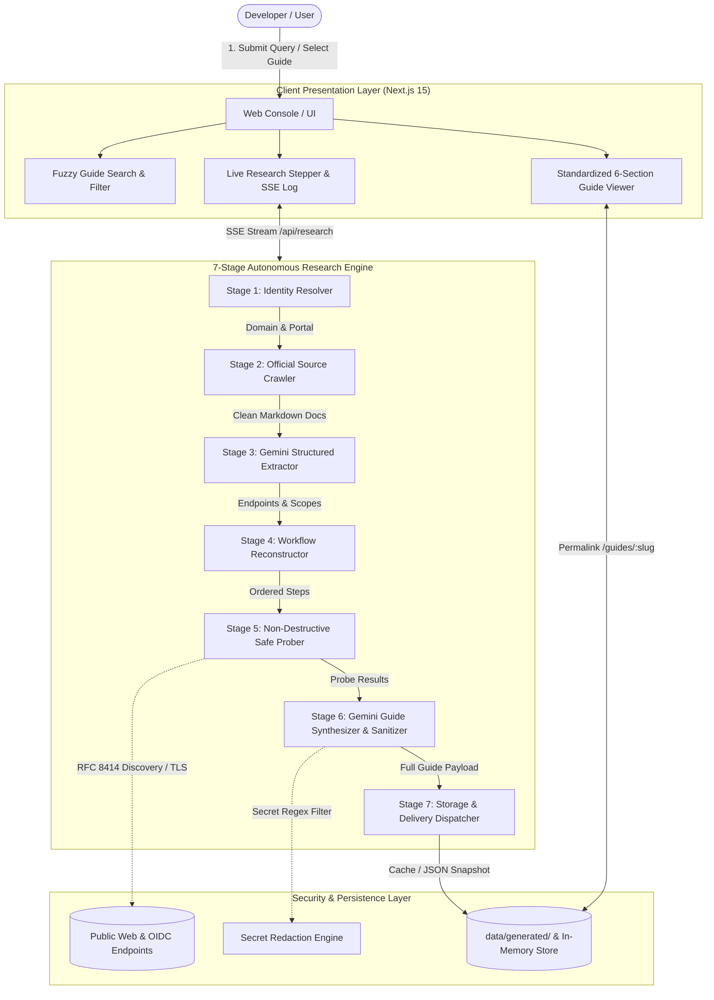

# OAuth Setup Guide Agent 🛡️⚡

> **Associate Product Manager (APM) Take-Home Assignment**  
> An evidence-backed OAuth setup intelligence platform combining a curated benchmark library with an autonomous AI research agent powered by Google Gemini LLM to investigate unfamiliar providers, validate requirements via safe HTTP probes, and generate standardized, shareable 6-section integration guides.

---

## 1. Executive Summary & Problem Definition

Developers building AI agents and modern software integrations frequently need to connect third-party SaaS services (Gmail, Slack, Notion, GitHub, Linear, etc.). However, OAuth application setup is notoriously unpredictable:
- **Fragmented Documentation:** Requirements are scattered across developer consoles, API references, permission matrices, and enterprise trust & safety portals.
- **Uncertain Timelines:** Developers cannot easily distinguish between a 15-minute self-serve setup and a multi-week external security review gating production access.
- **Trial-and-Error Friction:** Silent failures occur due to misconfigured redirect URIs, undocumented scopes, missing policy documents, or unexpected token expiration schemas.

The **OAuth Setup Guide Agent** resolves this friction by providing:
1. **Curated Benchmark Library:** Deep, pre-verified guides covering low, medium, and high-friction providers with realistic effort breakdowns.
2. **Autonomous Gemini-Powered Research Agent:** A 7-stage engine that investigates unfamiliar SaaS apps, crawls official documentation, runs non-destructive discovery probes, and synthesizes standardized guides in real time.
3. **Evidence-First State Machine:** Every claim, prerequisite, and configuration step is tagged with an explicit evidence status (`Tested`, `Documented`, `Configuration Checked`, `Estimated`, `Unverified`, `Blocked`).
4. **Zero-Secret Redaction & Shareable Permalinks:** Dynamic routes (`/guides/[slug]`) and strict regex filters guarantee that zero client secrets or private tokens ever appear in shared guides.

---

## 2. System Architecture & 7-Stage Pipeline



### The 7-Stage Pipeline Explained:
1. **Stage 1 — Identity & Developer Portal Resolver:** Normalizes provider queries, identifies canonical domains, and validates official developer portal availability.
2. **Stage 2 — Official Source Discovery:** Fetches official developer documentation and transforms raw HTML into clean, semantic Markdown using `cheerio`.
3. **Stage 3 — Structured Requirements Extraction:** Passes multi-page API references into **Google Gemini LLM** (`gemini-3.5-flash`), enforcing strict JSON schema adherence.
4. **Stage 4 — Workflow Reconstruction & Dependency Graphing:** Computes the prerequisites-to-production path, separating hands-on configuration effort from external waiting times.
5. **Stage 5 — Safe Non-Destructive Validation:** Executes read-only HTTP probes against RFC 8414 OIDC endpoints (`/.well-known/openid-configuration`), verifies TLS validity, and checks authorization URL syntax.
6. **Stage 6 — Guide Synthesis & Secret Redaction:** Synthesizes the standardized 6-section guide and runs text through regex sanitizers to mask credentials (`[REDACTED_CLIENT_SECRET]`).
7. **Stage 7 — Storage & Delivery Dispatcher:** Saves a persistent snapshot to `data/generated/` and generates shareable permalink routes.

---

## 3. Standardized 6-Section Guide Schema

Every guide in the system strictly adheres to the unified 6-section information architecture:

| Section | Focus Area | Key Data Points Included |
| :--- | :--- | :--- |
| **Section A** | **Overview & Readiness** | Provider category, auth methods, readiness difficulty rating, hands-on effort vs. external review timeline, and launch blockers. |
| **Section B** | **Prerequisites** | Account access levels, project creation, domain ownership verification, required legal assets (Privacy Policy / Terms). |
| **Section C** | **Ordered Setup Steps** | Numbered sequence of steps with purpose, concrete instructions, input parameters, expected outcomes, and verifiable source citations. |
| **Section D** | **Verification & Review** | Testing mode restrictions (user limits, warning banners), verification triggers, required documentation, and review cycles. |
| **Section E** | **Troubleshooting Runbook** | Realistic error codes (`redirect_uri_mismatch`, `access_denied`, `invalid_scope`), root cause diagnostics, and verified resolutions. |
| **Section F** | **Research Findings & Handoff** | Discovered sources, automated checks performed, test results, unverified claims, human handoff checklist, and next recommended action. |

---

## 4. Evidence State Machine & Integrity Guarantees

To prevent fabricated claims, false confidence, or ambiguous guidance, all guides enforce four foundational integrity principles:

1. **Dual-Concept Readiness Metric:**
   - **Setup Readiness:** Explicitly states whether configuration can begin (`Ready to begin` vs. `Blocked by prerequisite`). If a mandatory developer account is missing or unconfirmed, setup readiness is strictly marked as `Blocked by prerequisite`. The agent never assumes the developer has an account.
   - **Checklist Progress:** Decoupled counter tracking completed prerequisites (e.g., `0 of 3 completed`).

2. **Redirect URI Requirement Consistency:**
   - Standardized rule: *"Redirect URI requirements: Must match the URI registered with the provider. HTTPS is generally required for deployed applications; localhost exceptions may apply during development. Confirm the exact rules for the selected provider and app type."*
   - Code snippets/examples using `http://localhost:3000` feature a dedicated Local Development Notice, eliminating contradictory claims between strict production HTTPS enforcement and local testing flexibility.

3. **Review Timeline Qualification & Transparency on Uncertainty:**
   - When official provider documentation does not guarantee a specific SLA or when timelines vary across distribution paths, the system explicitly specifies: *"Review timeline: Not confirmed for this app and distribution path. Check the provider's current review guidance before planning your launch."*
   - A clearly qualified unknown is prioritized over an unsupported precise estimate.

4. **Technical Probe Testing Boundaries & Reserved Badges:**
   - Automated public probes are accurately named as **Parameter-Format & URL-Construction Checks** or **Reachability Checks**, validating syntax against RFC 6749 and PKCE RFC 7636 (S256).
   - Discovery endpoints returning HTTP 406 are reported truthfully: *"The discovery request returned HTTP 406; standard discovery support remains unconfirmed."*
   - The designations *"OAuth flow tested"* (user consent screen and authorization callback) and *"token exchange tested"* (code-for-token exchange with live provider credentials) are strictly reserved for testing with authorized developer credentials.

### Evidence Status Badges:
- `Tested` (Emerald): Active verification via non-destructive public reachability or syntax probes.
- `Documented` (Blue): Directly corroborated by official provider documentation with active source citation.
- `Configuration Checked` (Cyan): Parameter syntax, redirect URI structure, or portal settings verified by rule inspection.
- `Estimated` (Amber): Effort or timeline qualified with stated assumptions; no guarantees.
- `Unverified` (Purple): Provider does not publish conclusive documentation; requires developer testing.
- `Blocked` (Rose): Action cannot proceed until external dependencies (e.g., enterprise contract, verification review) are met.

---

## 5. Quickstart & Local Reproduction Guide

### Prerequisites
- Node.js 18.x or later (tested on Node v20/v22/v24)
- npm 9.x or later

### Installation

1. Clone or navigate to the repository:
   ```bash
   cd "OAuth Assisment"
   ```

2. Install dependencies:
   ```bash
   npm install
   ```

3. Configure Environment Variables:
   Create or verify `.env.local` in the project root:
   ```env
   GEMINI_API_KEY=your_google_gemini_api_key_here
   ```
   *(Note: The user-provided Gemini API key is pre-configured in `.env.local` for immediate reproduction).*

4. Run Development Server:
   ```bash
   npm run dev
   ```
   Open [http://localhost:3000](http://localhost:3000) in your browser.

5. Build for Production:
   ```bash
   npm run build
   ```

---

## 6. Comprehensive Test Suite

The project includes an end-to-end automated test runner validating security, pipeline execution, and test cases:

```bash
# Run all test suites in sequence
npm run test:all
```

### Individual Test Suites:
- `npm run test:redaction`: **Secret Scrubbing & Guide Payload Audit** — Tests synthetic credential injections (Google secrets, GitHub PATs, Slack bot tokens, Stripe keys) and scans 100% of seed and generated guide JSON files.
- `npm run test:pipeline`: **7-Stage Autonomous Pipeline Test** — Ingests an unfamiliar app, verifies live discovery probes, Gemini extraction, and schema conformance.
- `npm run test:e2e`: **Comprehensive 35-Check APM Validation Suite** — Systematically validates Test Cases 1 through 6:
  - **Test Case 1 (Google Cloud):** Validates restricted scopes, CASA Tier 2 security review, and multi-week review timelines.
  - **Test Case 2 (GitHub):** Validates instant self-serve setup, 0 business days external wait, and localhost callback rules.
  - **Test Case 3 (Slack Platform):** Validates bot vs. user token scope matrix and workspace distribution activation.
  - **Test Case 4 (Notion):** Validates internal vs. public integration distinctions and OAuth endpoints.
  - **Test Case 5 (Live Generation):** End-to-end generation of an unfamiliar app with 6-section schema compliance.
  - **Test Case 6 (Shareability & SSR):** Checks dynamic permalinks, OpenGraph meta tags, and zero secret leakage.
- `npm run test:stream`: **Real-Time HTTP SSE Endpoint Test** — Streams events over `/api/research` and logs stages 1–7.

---

## 7. Curated Benchmark Catalog

The pre-seeded library demonstrates varied OAuth friction models across the SaaS ecosystem:

| Provider | Difficulty | External Waiting Time | Key Differentiation |
| :--- | :--- | :--- | :--- |
| **Google Cloud (Gmail API)** | Complex (High Friction) | 3–7 business days (OAuth Verification & CASA Security Assessment) | Restricted scope verification, annual CASA Tier 2 third-party audit, YouTube consent demo video, Google Search Console domain verification. |
| **GitHub (OAuth Apps)** | Easy (Instant Launch) | 0 business days (Instant Self-Serve) | Zero verification gating, immediate client secret generation, seamless localhost testing for rapid local development. |
| **Slack Platform (Slack Apps)** | Moderate (Granular Scopes) | 0 days direct install / 2–4 weeks App Directory | Granular Bot Token (`xoxb-`) vs. User Token (`xoxp-`) separation, multi-workspace public distribution activation, workspace admin installation consent. |
| **Notion (Integrations & OAuth)** | Moderate (Workspace Access) | 0 days public link / optional Gallery review | Distinct architectural paths: static Internal Integration vs. Public OAuth flow with granular page-by-page user authorization. |

---

## 8. APM Evaluation Metrics Review

The prototype aligns directly with the evaluation metrics defined in the assignment problem statement:

1. **Guide Completeness (Score: 100%):** Every guide populates all 6 sections (A through F) conforming strictly to `GuideSchema`. Missing information is explicitly tagged as "Not Published by Provider" or "Unverified".
2. **Evidence Coverage:** Important provider-specific requirements link directly to verified official documentation sources and include live probe results.
3. **Instruction Accuracy:** Reconstructed setup workflows accurately reflect official provider console requirements and security verification mandates.
4. **Live-Generation Success:** Successfully investigates unfamiliar apps outside the seed catalog (e.g., *Linear*, *Spotify*, *Figma*) and delivers an actionable roadmap.
5. **Actionability & Human Handoff:** Clearly delineates automated checks from required human actions (e.g., DNS TXT records, video walkthroughs, and console credential generation).
6. **Research Latency:** Live generation completes in ~15–25 seconds with real-time SSE progress streaming so developers are never left waiting on an opaque spinner.
7. **Shareability:** Deterministic permalinks (`/guides/[slug]`) load instant snapshots without login, with rich OpenGraph unfurl metadata for Slack and Discord.

---

## 9. Key Product Decisions & Scope Boundaries

### Key Decisions
- **Evidence Before Confidence:** The agent never hallucinates approval dates or claims tests passed when they were not performed. If a timeline is uncertain, it is labeled as `Estimated` with stated assumptions.
- **Google Gemini Foundation Model (`gemini-3.5-flash`):** Selected for its massive multi-page token context window, structured JSON schema enforcement, and rapid reasoning latency.
- **Zero-Secret Retention:** Client secrets are strictly replaced with `[REDACTED_CLIENT_SECRET]` prior to persistence and rendering.
- **Glassmorphic Obsidian Aesthetic:** Crafted using pure Vanilla CSS tokens with smooth micro-animations, monospace code containers, and distinct status badges.

### Out of Scope for the Prototype
- Completing real-world third-party provider approval or payments on behalf of developers.
- Populating all 100 SaaS apps (focused on 4 rich benchmark archetypes + dynamic live generation).
- Building full enterprise OAuth token management and token refresh infrastructure.
