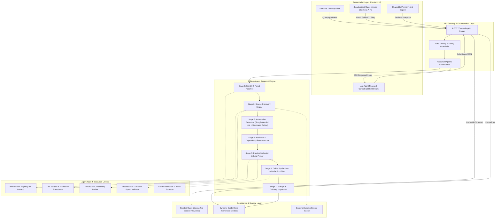
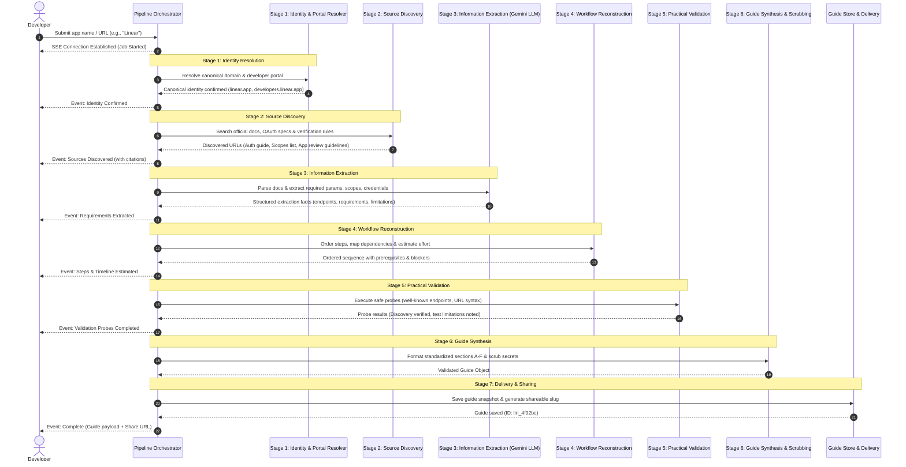
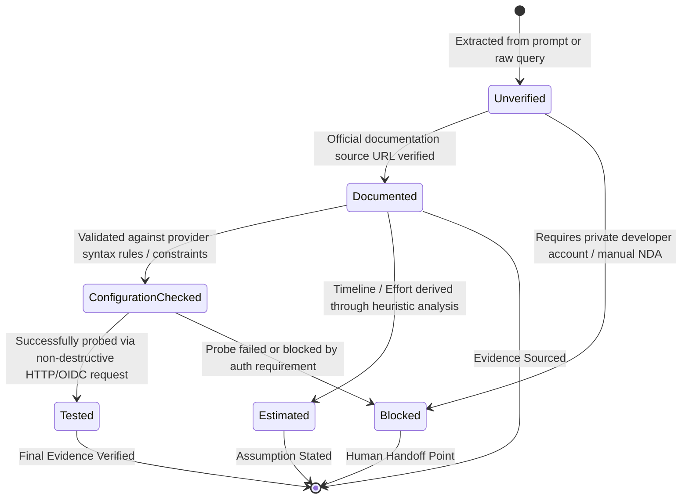

# System Architecture: OAuth Setup Guide Agent

## 1. Architectural Overview & Design Philosophy

The **OAuth Setup Guide Agent** is designed as a hybrid knowledge-retrieval and agentic research platform. It addresses the fragmentation, uncertainty, and manual overhead developers face when integrating third-party OAuth 2.0 services.

### 1.1 Architectural Objectives
- **Dual-Mode Operation:** Deliver instant, pre-verified guidance for common OAuth providers (e.g., Google, GitHub, Slack, Notion) via a curated guide library, while supporting real-time, autonomous investigation for unfamiliar or custom SaaS platforms via an agentic research pipeline.
- **Evidence-First Integrity:** Every instruction, endpoint, and prerequisite is tied to an explicit verification state (`Documented`, `Configuration Checked`, `Tested`, `Estimated`, `Unverified`, or `Blocked`) with verifiable source attribution.
- **Deterministic Guide Schema:** Live agent research outputs adhere strictly to a standardized 6-section schema (Sections A through F), ensuring uniform readability, machine-parseability, and predictable developer handoffs.
- **Security & Privacy by Design:** The system operates strictly within safe validation boundaries, enforcing client-side and server-side secret redaction so sensitive credentials, tokens, and personal data are never persisted or exposed in shareable URLs.
- **Maintainable & Budget-Conscious:** The design avoids unnecessary multi-agent sprawl, employing a modular, single-orchestrator pipeline with deterministic tool interfaces suitable for rapid implementation and production extension.
- **Google Gemini LLM Intelligence Backbone:** Built on Google Gemini models (Gemini 1.5/2.0 Flash and Pro) using large-context document ingestion and native Structured Outputs (JSON Schema enforcement via `responseSchema`) to reliably extract facts, reconstruct dependency graphs, and generate strictly schema-compliant guides.

---

## 2. High-Level System Architecture

The following diagram illustrates the end-to-end architecture across the Client, Orchestration, Agentic Pipeline, Tools, and Persistence layers:



---

## 3. Subsystem Decomposition & Component Responsibilities

### 3.1 Presentation Layer (Frontend)
- **Search & Directory Interface:** Provides fuzzy autocomplete and keyword search across pre-indexed provider guides (by name, API categories, difficulty, managed OAuth availability).
- **Interactive Guide Viewer:** Renders the standardized 6-section guide structure with:
  - Visual status chips (`Documented`, `Tested`, `Blocked`, etc.).
  - Step-by-step ordered accordion/checklists with input/output matrices.
  - Interactive copy-to-clipboard buttons for scopes, endpoints, and redirect URLs.
  - Collapsible diagnostic runbooks for provider-specific error scenarios.
- **Live Research Agent Console:** Renders real-time feedback during live generation, showing step-by-step progress through the 7 stages, inspected URLs, extracted claims, and validation results.
- **Shareable Permalink View:** Delivers a lightweight, clean, read-only view accessible via permanent slug/UUID without authentication hurdles.

### 3.2 API & Orchestration Layer (Backend)
- **Route Handlers:**
  - `GET /api/guides` — Search and filter curated and generated guides.
  - `GET /api/guides/:id` — Fetch complete guide document by ID or slug.
  - `POST /api/research` — Initiate live research pipeline for an unfamiliar provider (returns an SSE stream or job ID).
  - `GET /api/research/:jobId/stream` — Server-Sent Events (SSE) feed emitting incremental stage milestones, discovered sources, and the finalized guide.
- **Pipeline Orchestrator:** Manages execution flow, execution timeouts, error recovery, step retries, and fallback mechanisms when documentation is incomplete or ambiguous.

### 3.3 Agent Tools & Utilities
- **Domain & Portal Resolver:** Normalizes user inputs (e.g., `"Notion"`, `"https://notion.so"`, `"notion api"`) into canonical provider names, root websites, and developer console URLs.
- **Official Documentation Crawler:** Performs targeted web searches prioritizing official developer subdomains (`developer.*`, `docs.*`, `api.*`), parses HTML to semantic Markdown, and strips navigation boilerplate.
- **Safe Prober & Endpoint Validator:** Executes non-destructive checks against public endpoints:
  - Probes RFC 8414 OAuth 2.0 Authorization Server Metadata (`/.well-known/oauth-authorization-server` or `/.well-known/openid-configuration`). When an endpoint returns HTTP 406, it is reported transparently as *"The discovery request returned HTTP 406; standard discovery support remains unconfirmed"* rather than overclaiming provider non-support.
  - Parameter-Format & URL-Construction Validator: Formally checks constructed authorization URLs against RFC 6749 and PKCE RFC 7636 (S256) syntax specifications.
  - Reserved Testing Badges: Distinguishes between automated public probes and credentialed execution. The badges *"OAuth flow tested"* (live user consent and redirect callback) and *"token exchange tested"* (authorized code-for-token exchange) are strictly reserved for testing with real developer credentials.
  - Verifies redirect URI requirements: Confirms that registered URIs match provider rules, noting that HTTPS is generally required for deployed applications while localhost exceptions apply during development.
  - Verifies HTTP status codes and TLS certificate validity for developer portals.
- **Secret Redaction & Token Scrubber:** Inspects text outputs via regex and heuristic parsers to eliminate accidental client secrets, bearer tokens, API keys, or private credential patterns.

### 3.4 Data & Persistence Layer
- **Curated Store (`DB_Seed`):** Contains validated, high-quality pre-built guides for benchmark services (e.g., Google OAuth 2.0, GitHub Apps/OAuth, Slack Apps, Notion Integrations) stored in version-controlled JSON/Markdown format.
- **Dynamic Store (`DB_Dynamic`):** Persists dynamically generated guides keyed by a stable hash of the canonical provider identity, enabling permalinks and instant subsequent access.
- **Evidence & Document Cache (`DB_Cache`):** Stores crawled documentation snippets, HTTP probe responses, and extraction timestamps to minimize external latency and ensure reproducibility.

### 3.5 LLM Engine: Google Gemini Integration
The research and synthesis pipeline relies on Google Gemini LLM as its core reasoning and intelligence backbone:
- **Long-Context Ingestion (1M+ Tokens):** OAuth documentation, scopes reference tables, and developer console manuals often span tens of thousands of tokens. Google Gemini can ingest entire multi-page documentation sets in a single prompt without lossy chunking, preserving nuanced dependencies between requested scopes, application types, and verification tiers.
- **Native Structured Outputs (`responseSchema`):** Enforces 100% deterministic schema adherence at the decoding level (`responseMimeType: "application/json"`), ensuring generated guides reliably populate Sections A through F without syntax errors or missing required fields.
- **Dual-Model Tiering:**
  - **Gemini Flash (e.g., Gemini 1.5 / 2.0 Flash):** Low-latency execution for Stage 1 identity verification, Stage 2 documentation relevance ranking, and Stage 5 validation probe analysis.
  - **Gemini Pro (e.g., Gemini 1.5 / 2.0 Pro):** Deep reasoning for Stage 3 requirements extraction, Stage 4 workflow dependency graph reconstruction, and Stage 6 actionable guide synthesis.

---

## 4. The 7-Stage Agentic Research Pipeline



### Detailed Breakdown of Pipeline Stages

1. **Stage 1: Input and Identification**
   - Resolves the target service from free-form user query (e.g. `"hubspot"`, `"Figma"`, `"https://box.com"`).
   - Identifies the organization's canonical root domain and dedicated developer portal URL.
   - Flags ambiguity immediately if multiple conflicting entities match.

2. **Stage 2: Source Discovery**
   - Issues targeted search queries targeting authentic developer references:
     - `"<Provider> OAuth 2.0 developer guide registration"`
     - `"<Provider> API permissions scopes"`
     - `"<Provider> app review verification requirements redirect uri"`
   - Retrieves document text, filters out marketing copy, and extracts metadata (canonical URLs, publish/update timestamps).

3. **Stage 3: Information Extraction**
   - Uses Google Gemini LLM with native structured outputs (`responseSchema`) to ingest long documentation sets and extract atomic technical facts:
     - Client registration model (Portal location, self-serve vs. manual request).
     - Endpoints (Authorization URL, Token URL, Revocation URL, JWKS / UserInfo).
     - Grant types supported (Authorization Code with PKCE, Client Credentials, Refresh Tokens).
     - Redirect URI restrictions (HTTP vs HTTPS, localhost handling, port wildcards).
     - Permission scopes format and mandatory scopes.
     - Production gating (Verification tiers, required legal URLs, brand review timelines).

4. **Stage 4: Workflow Reconstruction & Effort Estimation**
   - Constructs a directed dependency graph of setup actions (e.g., Step 1: Create Organization Account $\to$ Step 2: Register App $\to$ Step 3: Configure Redirects $\to$ Step 4: Request Sensitive Scopes $\to$ Step 5: Test via Sandbox).
   - Computes:
     - **Hands-on Effort:** Quantitative calculation based on configuration complexity (e.g., 20–45 mins).
     - **External Waiting Time:** Documented provider review latencies or explicitly designated as *None / Immediate* or *Unspecified / Varies*.

5. **Stage 5: Practical Validation**
   - Non-intrusively probes public endpoints:
     - Validates HTTP response headers on documentation and authorization domains.
     - Checks standard OpenID/OAuth discovery documents (`/.well-known/openid-configuration`).
     - Tests constructed authorization URL syntax for valid query parameters (`client_id`, `redirect_uri`, `scope`, `response_type`, `state`, `code_challenge`).
   - Tags each step with evidence status based on actual observations.

6. **Stage 6: Guide Synthesis & Redaction**
   - Uses Google Gemini LLM to synthesize the standardized 6-section guide schema from validated findings.
   - Identifies human intervention points (e.g., *"Action required: Developer must accept API terms in console"*).
   - Applies automated token/secret redaction filters to prevent accidental disclosure of private test data.

7. **Stage 7: Guide Delivery & Permalinking**
   - Generates a permanent URL slug based on provider ID and generation timestamp.
   - Persists the canonical JSON document into storage.
   - Emits terminal completion event to the developer.

---

## 5. Standardized Guide Data Model & JSON Schema

All guides—whether pre-seeded in the library or synthesized on the fly—conform to this unified JSON structure:

```json
{
  "$schema": "http://json-schema.org/draft-07/schema#",
  "id": "guide_google_oauth2",
  "slug": "google-workspace-oauth",
  "provider": {
    "name": "Google Cloud Platform",
    "officialWebsite": "https://cloud.google.com",
    "developerPortal": "https://console.cloud.google.com/apis/credentials",
    "authMethod": "OAuth 2.0 (Authorization Code with PKCE)",
    "managedOAuthAvailable": true
  },
  "readiness": {
    "difficulty": "Moderate",
    "handsOnEffort": "30-60 minutes",
    "externalWaitingTime": "3-7 business days for sensitive/restricted scopes; 0 days for internal/testing mode",
    "launchBlockers": [
      "OAuth Consent Screen verification required for external users with sensitive scopes",
      "Domain ownership verification required via Google Search Console"
    ]
  },
  "prerequisites": [
    {
      "category": "Account Access",
      "description": "Google Cloud account with Project Creator role",
      "required": true
    },
    {
      "category": "Assets & Documents",
      "description": "Publicly accessible Privacy Policy and Terms of Service URLs",
      "required": false,
      "condition": "Required only when switching consent screen from Testing to Production"
    }
  ],
  "steps": [
    {
      "stepNumber": 1,
      "title": "Create or Select a Google Cloud Project",
      "purpose": "All credentials and API quotas are scoped to a specific GCP project.",
      "instructions": "Navigate to the Project Selector in GCP Console and click 'New Project'.",
      "inputsRequired": ["Project Name", "Organization (optional)"],
      "expectedOutcome": "GCP Project ID created and active in console header.",
      "sourceUrl": "https://developers.google.com/workspace/guides/create-project",
      "evidenceStatus": "Documented",
      "dependencies": []
    }
  ],
  "verification": {
    "testingModeSupported": true,
    "testingRestrictions": "Limited to 100 designated test users; unverified app warning screen displayed",
    "verificationTriggers": [
      "Requesting sensitive scopes (e.g., Gmail, Drive)",
      "Switching publishing status to 'In Production' with an external user type"
    ],
    "reviewTimelines": "3 to 7 business days per review round",
    "unknowns": []
  },
  "troubleshooting": [
    {
      "errorCode": "redirect_uri_mismatch",
      "description": "The redirect URI in the request does not match the ones added in the GCP Console.",
      "probableCauses": ["Trailing slash differences", "HTTP vs HTTPS scheme mismatch", "Mismatched port number"],
      "resolution": "Ensure the redirect URI matches character-for-character under Credentials > Authorized redirect URIs."
    }
  ],
  "agentFindings": {
    "sourcesConsulted": [
      {
        "title": "Google Identity OAuth 2.0 Documentation",
        "url": "https://developers.google.com/identity/protocols/oauth2"
      }
    ],
    "testsAttempted": [
      {
        "test": "Discovery Endpoint Probe",
        "endpoint": "https://accounts.google.com/.well-known/openid-configuration",
        "status": "Success",
        "observedResult": "HTTP 200 OK with valid authorization and token endpoint URLs"
      }
    ],
    "unverifiedClaims": [],
    "humanActionRequired": [
      "Manual click-through of OAuth Consent Screen setup",
      "Verification video submission if requesting restricted scopes"
    ],
    "nextRecommendedAction": "Configure OAuth Consent screen before generating Client ID credentials."
  },
  "metadata": {
    "generatedAt": "2026-10-22T18:30:00Z",
    "schemaVersion": "1.0.0",
    "isCurated": true
  }
}
```

---

## 6. Evidence & Verification State Machine

To prevent misinformation, hallucinations, or false confidence, each requirement, step, and claim is evaluated against an explicit state machine:



### 6.1 Readiness, Timeline & Evidence Integrity Guarantees

To ensure the product provides trustworthy, evidence-backed guidance without false claims or ambiguity, the architecture enforces four foundational integrity principles:

1. **Dual-Concept Readiness Metric:**
   - **Setup Readiness:** Evaluates whether developer configuration can immediately start (`Ready to begin` vs. `Blocked by prerequisite`). If a mandatory developer account is missing or unconfirmed, setup readiness is strictly marked as `Blocked by prerequisite`. The agent never assumes the developer has an account.
   - **Checklist Progress:** Quantifies prerequisite completion as a discrete counter (e.g., `0 of 3 completed`), decoupling progress tracking from launch readiness.

2. **Redirect URI Requirement Consistency:**
   - Standardized definition: *"Redirect URI requirements: Must match the URI registered with the provider. HTTPS is generally required for deployed applications; localhost exceptions may apply during development. Confirm the exact rules for the selected provider and app type."*
   - Code snippets and config examples using `http://localhost:3000` are explicitly annotated with a dedicated Local Development Notice, eliminating contradictory claims between strict production HTTPS enforcement and local testing flexibility.

3. **Review Timeline Qualification & Transparency on Uncertainty:**
   - When official provider documentation does not guarantee a specific SLA or when timelines vary across distribution paths, the architecture rejects fabricated ranges (e.g., ungrounded "10–15 business days").
   - Instead, the system explicitly specifies: *"Review timeline: Not confirmed for this app and distribution path. Check the provider's current review guidance before planning your launch."*
   - Transparently qualified unknowns are elevated over unsupported precise estimates.

4. **Technical Probe Testing Boundaries & Reserved Badges:**
   - Automated public probes are accurately named as **Parameter-Format & URL-Construction Checks** or **Reachability Checks**, validating syntax against RFC 6749 and PKCE RFC 7636 (S256).
   - Discovery endpoints returning HTTP 406 are explicitly reported as: *"The discovery request returned HTTP 406; standard discovery support remains unconfirmed."*
   - Badges designating *"OAuth flow tested"* (user consent screen and authorization callback) and *"token exchange tested"* (code-for-token exchange with live provider credentials) are strictly reserved for testing with authorized credentials.

### 6.2 Step Completion States & Separation of Developer Progress from Agent Evidence

To prevent confusion between **Agent Evidence** (what the autonomous research agent has verified from official documentation) and **Developer Progress** (what the developer has actually executed locally), Section C enforces a clean separation of concerns:

1. **Consistent Step Completion States:**
   Every step across every guide supports a standardized set of developer progress states:
   - `Not started`: Step has not yet been executed by the developer.
   - `In progress`: Developer is actively performing this step in the provider console or codebase.
   - `Documented`: Official instructions, required parameters, and outcomes are fully documented and ready for execution.
   - `Configuration checked`: Inputs, scopes, and environment variables have been validated against schema constraints.
   - `Tested`: Step has been successfully executed and validated locally or in sandbox.
   - `Blocked`: Step execution is currently impeded by an external blocker (e.g., pending account approval, permission missing).
   - `Completed`: Step is fully executed and marked done.

2. **Independence of Evidence Status vs Developer Progress:**
   - **Agent Evidence Status** (`Documented`, `Configuration Checked`, `Tested`, `Estimated`, `Unverified`, `Blocked`): Reflects research verification against official provider documentation and automated probes. A step can be fully `Documented` by the agent even if the developer has `Not started` or is `In progress`.
   - **Developer Progress** (`Not started`, `In progress`, `Documented`, `Configuration checked`, `Tested`, `Blocked`, `Completed`): Represents real-world developer implementation state, controllable via interactive checkboxes and progress state dropdowns on each step.

### 6.3 Dynamic Next Action Derivation Engine

Static hand-off recommendations become obsolete as soon as a developer begins executing setup. Rather than displaying hardcoded advice, the system dynamically calculates the next recommended action in Section F grounded directly in real-time progress data:

1. **Priority 1: Earliest Incomplete or Blocked Prerequisite in Section B:**
   - Evaluates checklist items in Section B.
   - If mandatory developer account access is unconfirmed, dynamically recommends: *"Sign in or register a <Provider> Developer Account"*, with why-agent-cannot-do-it, prerequisite links, and jump-to-section navigation.
   - If other prerequisites are missing, recommends fulfilling the earliest unconfirmed prerequisite.

2. **Priority 2: Sequential Step Execution in Section C:**
   - Once all Section B prerequisites are confirmed, scans Section C steps in sequential order (Steps 1 through $N$).
   - Dynamically recommends the earliest incomplete step:
     - **Step 1:** Access developer console and create application entry.
     - **Step 2:** Register client credentials and store securely.
     - **Step 3:** Configure and verify authorized redirect callback URLs (`redirect_uri` exact match).
     - **Step 4:** Select API scopes and assign environment secrets.
     - **Step 5:** Verify redirect callback and test authorization code token exchange.
   - Automatically provides a "Jump to Step $X$" button that scrolls directly to and expands the active step.

3. **Priority 3: Section D Production Launch Verification:**
   - When all steps 1 through $N$ are completed or tested, the hand-off dynamically transitions to recommending the Section D launch review checklist and marketplace submission.

4. **Underlying State Grounding:**
   - The derivation directly updates the underlying guide model (`guide.agentFindings.dynamicNextAction` and `guide.agentFindings.nextRecommendedAction`), ensuring that data exported, shared, or persisted remains 100% synchronized with the reactive UI state.

---

## 7. Security, Privacy & Sanitization Architecture

Because OAuth integrations handle sensitive client IDs, secrets, redirect URIs, and user permissions, the architecture implements rigid safety boundaries:

```mermaid
graph LR
    subgraph InputProcessing["Ingestion & Scraping"]
        RawInput["User Input / Crawled HTML"] --> ContentFilter["XSS & Prompt Injection Filter"]
    end

    subgraph AgentExecution["Agent Execution Sandbox"]
        ContentFilter --> Extractor["Structured Extractor"]
        Extractor --> Synthesis["Guide Synthesis"]
    end

    subgraph SafetyGate["Sanitization Boundary"]
        Synthesis --> Redactor["Secret & Token Redaction Engine"]
        Redactor --> Validator["JSON Schema & Link Validator"]
    end

    subgraph PublicDelivery["Shareable Layer"]
        Validator --> PublicStorage["Sanitized Guide Store"]
        PublicStorage --> ShareLink["Public Permalinks"]
    end
```



### Key Security Safeguards:
1. **Zero Secret Retention:**
   - The agent never requests, stores, or echoes client secrets, refresh tokens, access tokens, or private keys.
   - Any string matching credential patterns (e.g., `client_secret_.*`, `ghp_.*`, `xoxb-.*`, `Bearer eyJ.*`) is automatically masked to `[REDACTED_CLIENT_SECRET]`.
2. **Safe Probing Only:**
   - Probing tools are strictly read-only and restricted to public HTTP `GET` / `HEAD` requests.
   - No automated account creation, form submissions, or OAuth consent authorizations are performed on third-party sites.
3. **URL & Domain Whitelisting:**
   - Web crawlers are constrained to official domains and verified documentation paths to prevent Server-Side Request Forgery (SSRF) against internal networks (`localhost`, `169.254.169.254`, private RFC 1918 subnets).
4. **Permalinks without State Pollution:**
   - Shareable guide links are rendered from immutable, sanitized guide snapshots, preventing injection attacks via URL query parameters.

---

## 8. Technology Stack & Implementation Blueprint

To deliver a reliable, responsive, and aesthetically modern experience within the take-home project budget, the following technology stack is selected:

| Architectural Tier | Technology Choice | Rationale |
| :--- | :--- | :--- |
| **Frontend Framework** | **React / Next.js or Vite + Vanilla CSS** | Rapid component development, clean client-side routing, and zero heavy dependencies. |
| **Styling & Aesthetics** | **Modern Glassmorphic CSS Design System** | Dark-mode native, fluid typography (Inter font family), micro-animations, and high visual polish. |
| **Backend & API** | **Node.js / Express or Next.js API Routes** | Native support for Server-Sent Events (SSE), streaming responses, and asynchronous tool orchestration. |
| **Agent / LLM Engine** | **Google Gemini LLM (Gemini 1.5 / 2.0 Flash & Pro via `@google/genai`)** | Native structured JSON schema enforcement (`responseSchema`), massive 1M+ token context window to ingest entire multi-page OAuth documentation without lossy chunking, fast inference, and robust reasoning for dependency graphs. |
| **Web Research & Scraping** | **Custom Search API / Fetch + Cheerio** | Fast, lightweight extraction of official documentation without heavy browser automation overhead. |
| **Persistence** | **Local File / SQLite / In-Memory with Seed JSON** | Zero-friction setup for local evaluation, instant reproducibility, and simple deployment. |

---

## 9. Failure Modes, Edge Cases & Resilience Strategies

| Scenario / Failure Mode | Root Cause | Architectural Mitigation |
| :--- | :--- | :--- |
| **Ambiguous App Name** (e.g., "Square" vs. "Squarespace") | Ambiguous user prompt. | Stage 1 halts and prompts the user for clarification with candidate options, or defaults to the most prominent match while labeling ambiguity in Section A. |
| **Walled / Gated Documentation** | Provider requires login or NDA to view developer docs. | Agent captures developer login URL, marks configuration as `Blocked`, documents prerequisites, and assigns human handoff instructions. |
| **Missing Review Timelines** | Provider documentation does not publish SLA or review turnaround times. | Guide explicitly indicates `Waiting Time: Not Published by Provider`, avoiding fabricated estimates. |
| **Documentation Inconsistency** | Outdated legacy v1 docs contradict newer v2 OAuth guides. | Agent prioritizes newer protocol specs (e.g., PKCE support) and adds an advisory note in Section E (Troubleshooting). |
| **Crawler Latency / Search Quota Exceeded** | External search throttling during live research. | In-memory source cache serves previously crawled documentation pages; fallback to fallback pre-indexed documentation corpus. |

---

## 10. Summary

The architecture of the **OAuth Setup Guide Agent** establishes a clear boundary between automated agentic research and human-required execution. By combining a pre-verified library with a 7-stage live research engine, a strict 6-section schema, an evidence-based verification state machine, and proactive secret sanitization, the system delivers trustworthy, actionable, and shareable OAuth setup roadmaps for developers.
