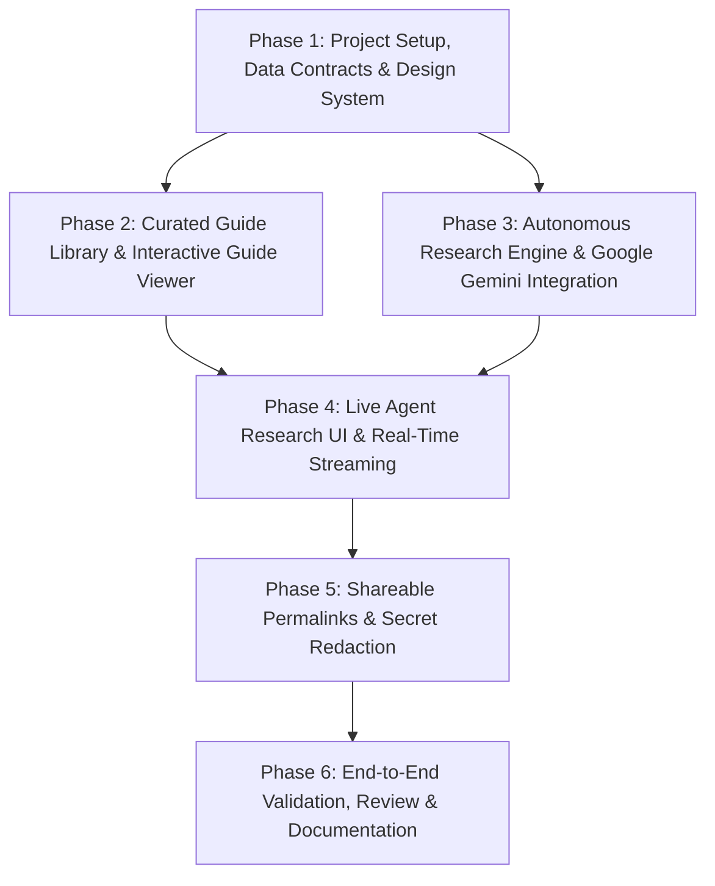
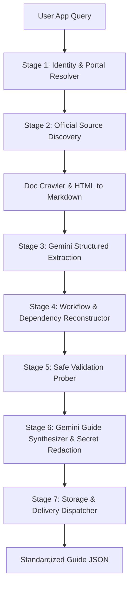

# Phase-Wise Implementation Plan: OAuth Setup Guide Agent

## 1. Overview and Implementation Strategy

This implementation plan outlines the phase-by-phase execution roadmap for building the **OAuth Setup Guide Agent** as defined in [`context.md`](file:///h:/Antigravity/OAuth%20Assisment/context.md) and [`architecture.md`](file:///h:/Antigravity/OAuth%20Assisment/architecture.md).

The implementation strategy focuses on delivering a reliable, verifiable, and user-friendly experience with architectural rigor:
- **Core Engine:** Powered by **Google Gemini LLM** using native Structured Outputs (`responseSchema`) and long-context documentation ingestion.
- **Dual Experience:** Delivers both an instant, pre-verified **Curated Guide Library** (covering 4 distinct apps with varied complexity) and an autonomous **Live Research Pipeline** for unfamiliar applications.
- **Production Foundations:** Employs a modern glassmorphic web interface, strict evidence attribution (`Documented`, `Tested`, `Blocked`, etc.), deterministic 6-section schema adherence, zero-secret persistence, and shareable permalinks.

---

## 2. Phase-by-Phase Milestone Summary & Dependency Graph

The phases follow a sequential dependency order where fundamental data models and UI components are established first, followed by the seed library and the autonomous Gemini research engine, ending with sharing, sanitization, and end-to-end validation:

| Phase | Milestone Name | Key Deliverables | Scope Focus |
| :--- | :--- | :--- | :--- |
| **Phase 1** | Project Setup & Design System | Next.js/Vite setup, strict TypeScript data models, dark-mode CSS tokens | Foundations |
| **Phase 2** | Curated Library & Guide Viewer | 4 curated seed guides, fuzzy search, full 6-section interactive viewer | Library Experience |
| **Phase 3** | Google Gemini Research Engine | 7-stage research orchestrator, doc crawler, safe prober, structured output | Core Intelligence |
| **Phase 4** | Live Agent Console & Streaming | Real-time SSE event pipeline, live stage indicators, source citation feed | Agent Interface |
| **Phase 5** | Permalinks & Secret Redaction | Shareable URL routes, snapshot persistence, automated token scrubber | Delivery & Security |
| **Phase 6** | E2E Testing & Documentation | Live test runs (e.g. Linear/HubSpot), README, evaluation metrics review | Verification |

---

## 3. Phase 1: Project Setup, Data Contracts & Design System

### Objectives
Establish the workspace environment, install core dependencies, define TypeScript data models matching the standardized 6-section specification, and create a sleek, modern design system.

### Tasks & Technical Execution

1. **Project Initialization:**
   - Initialize a modern web application (e.g., Next.js App Router or Vite + React + Express) with TypeScript.
   - Install required dependencies:
     - `@google/genai` or `@google/generative-ai` (Google Gemini SDK)
     - `cheerio` (Fast HTML parsing and text extraction)
     - `lucide-react` (Crisp iconography for evidence badges and steps)
     - `zod` (Runtime schema validation for Gemini structured output)

2. **Standardized TypeScript Data Contracts:**
   - Define canonical types in `src/types/guide.ts`:
     - `VerificationStatus`: `'Documented' | 'Configuration Checked' | 'Tested' | 'Estimated' | 'Unverified' | 'Blocked'`
     - `ReadinessStatus`: `'Ready to start' | 'Ready to begin' | 'Blocked by prerequisite' | 'Prerequisites missing' | 'Provider review required' | 'Important requirements unverified'`
     - Dual-Concept Readiness: Decouples **Setup readiness** (`Ready to begin` vs `Blocked by prerequisite`) from **Checklist progress** (`0 of 3 completed`). Setup readiness strictly reports `Blocked by prerequisite` if a mandatory developer account is missing/unconfirmed without assuming account possession.
     - `GuideSchema`: Encompassing Section A (Overview & Readiness), Section B (Prerequisites), Section C (Ordered Steps), Section D (Verification & Review), Section E (Troubleshooting Runbook), and Section F (Agent Findings & Citations).
     - `ResearchProgressEvent`: Typed streaming events emitted during live research.

3. **Modern CSS Design System (`src/styles/globals.css`):**
   - Palette: Sleek obsidian dark mode (`#0B0F19`, `#111827`, `#1E293B`) with indigo/violet accents (`#6366F1`, `#8B5CF6`).
   - Glassmorphism: `backdrop-filter: blur(12px)`, subtle border glows (`rgba(255, 255, 255, 0.08)`).
   - Typography: Clean sans-serif hierarchy using modern font stack.
   - Evidence Badge Component Styles: Distinct color-coded chips for each evidence state:
     - Green: `Tested`
     - Blue: `Documented`
     - Cyan: `Configuration Checked`
     - Amber: `Estimated` / `Unverified`
     - Rose: `Blocked` (Action Required)

### Acceptance Criteria
- [x] TypeScript builds with strict type checks enabled.
- [x] Design tokens and utility classes render responsive, glassmorphic card layouts.
- [x] `GuideSchema` precisely mirrors the product requirements specification, enforcing dual-concept readiness and redirect URI rule clarity.

---

## 4. Phase 2: Curated Guide Library & Interactive Guide Viewer

### Objectives
Deliver an instant-access library of benchmark OAuth guides covering varied setup requirements and build an intuitive, information-dense 6-section Guide Viewer.

### Tasks & Technical Execution

1. **Seed Data Creation (`src/data/seedGuides.ts`):**
   Craft 4 pre-verified, comprehensive guide fixtures representing diverse real-world integration challenges:
   - **Google Cloud / Gmail (High Friction):**
     - OAuth Consent Screen configuration (Internal vs External).
     - Scope gating (Restricted scopes such as `https://mail.google.com/`).
     - Verification requirements: Domain verification in Google Search Console, YouTube demo video, CASA Tier 2 security assessment, published review waiting time.
   - **GitHub OAuth App (Low Friction / Fast Self-Serve):**
     - Simple developer settings, personal vs. organization ownership.
     - Flexible redirect URIs (`http://localhost:3000/callback` supported).
     - Instant production token generation with no review delay.
   - **Slack App (Medium Friction / Granular Permissions):**
     - Bot token scopes vs. User token scopes.
     - Multi-step distribution: Direct Install vs. App Directory publication.
     - Workspace administrator authorization requirements.
   - **Notion Integration (Internal vs Public Distribution):**
     - Integration types: Internal Integration (Workspace secret) vs. Public OAuth.
     - Page-by-page capability grant model; workspace access picker.

2. **Searchable Directory Component (`src/components/GuideSearch.tsx`):**
   - Client-side fuzzy search across app name, category, and auth capabilities.
   - Quick filter chips: *All Apps*, *Instant Launch*, *Requires Provider Review*, *Managed OAuth Available*.
   - Responsive guide cards showing difficulty level, hands-on effort, and verification badges.

3. **Interactive 6-Section Guide Viewer (`src/components/GuideViewer.tsx`):**
   - **Header & Section A:** Status overview banner with difficulty chips, estimated effort timer, and launch blockers callout.
   - **Section B (Prerequisites):** Interactive checklist allowing developers to mark prerequisites completed with real-time progress counter and bar.
   - **Section C (Step-by-Step Setup):**
     - Execution progress counter and bar (`X of Y steps completed`).
     - Evidence vs Progress notice: Explicitly decoupling agent evidence (research verification from docs) from developer implementation progress.
     - Consistent step completion states across every step (`Not started`, `In progress`, `Documented`, `Configuration checked`, `Tested`, `Blocked`, `Completed`).
     - Interactive step completion checkbox and progress dropdown selector.
     - Separated Agent Evidence badge (`Evidence: Documented`, etc.).
     - Copyable code snippets, parameter tables, official source links, and local development notices.
   - **Section D (Verification & Readiness):** Clear distinction between Sandbox/Testing mode and Production gating triggers.
   - **Section E (Testing & Troubleshooting):** Collapsible error matrix with diagnosis steps for `redirect_uri_mismatch`, `invalid_scope`, `unauthorized_client`, etc.
   - **Section F (Dynamic Agent Findings & Next Action Hand-Off):**
     - Dynamic Next Action Engine: Reactively derives the next recommended action from actual prerequisite completion in Section B and step progress in Section C.
     - Unconfirmed prerequisite blockers automatically recommend account creation or prerequisite fulfillment.
     - Completing prerequisites advances the recommendation to Step 1, Step 3 (redirect callback), etc.
     - Completing all steps transitions recommendation to Section D production review.
     - Interactive jump buttons to scroll to and expand active prerequisite or step.
     - Evidence drawer listing all sources consulted, test probe logs, and automation boundaries.

### Acceptance Criteria
- [x] Users can search, filter, and open any of the 4 benchmark guides instantly.
- [x] All 6 sections (A through F) are cleanly rendered with interactive accordions and copyable parameters.
- [x] Verification badges accurately communicate the evidence state for each step.

---

## 5. Phase 3: Autonomous Research Engine & Google Gemini Integration

### Objectives
Build the 7-stage live research engine that takes any unfamiliar app name or website, searches official developer documentation, extracts requirements using Google Gemini LLM with structured outputs, performs safe validation checks, and constructs a complete guide.

### Tasks & Technical Execution

1. **Stage 1: Identity & Developer Portal Resolver:**
   - Normalizes input queries (e.g., `"Linear"`, `"hubspot.com"`).
   - Identifies the organization's official website and dedicated developer portal URL.
   - Verifies domain availability and detects potential name collisions.

2. **Stage 2: Official Source Discovery:**
   - Formulates targeted queries for official developer references:
     - `"<App Name> developer documentation OAuth 2.0 application registration"`
     - `"<App Name> API authorization scopes endpoints"`
     - `"<App Name> app review verification production requirements"`
   - Uses web search / custom search tools or documentation index.
   - Fetches target HTML and transforms it into clean, semantic Markdown using `cheerio`.

3. **Stage 3: Information Extraction with Google Gemini:**
   - Passes crawled documentation into Google Gemini LLM (e.g. `gemini-1.5-pro` or `gemini-1.5-flash`).
   - Enforces strict JSON Schema extraction via `responseSchema` to capture:
     - Auth endpoints (authorization, token, revocation, discovery).
     - Supported grant types (e.g., Authorization Code with PKCE).
     - Redirect URI syntax rules and port restrictions.
     - Required vs. optional scopes.
     - Production verification thresholds and required business documents.
   - Leverages Gemini's **1M+ token context window** to ingest multi-page API references without lossy chunking.

4. **Stage 4: Workflow Reconstruction & Effort Estimation:**
   - Resolves dependencies into an ordered sequence:
     1. Account registration $\to$ 2. App creation in console $\to$ 3. Redirect URI configuration $\to$ 4. Scope assignment $\to$ 5. Sandbox testing $\to$ 6. Production verification submission.
   - Enforces standard redirect URI definition: *"Redirect URI requirements: Must match the URI registered with the provider. HTTPS is generally required for deployed applications; localhost exceptions may apply during development. Confirm the exact rules for the selected provider and app type."*
   - Code snippets/examples using `http://localhost:3000` include explicit Local Development Notices.
   - Analyzes setup complexity to qualify hands-on effort and external review dependencies. Where official review timelines are not explicitly guaranteed in documentation for the app/path, specifies: *"Review timeline: Not confirmed for this app and distribution path. Check the provider's current review guidance before planning your launch."*

5. **Stage 5: Practical Validation Prober:**
   - Executes safe, read-only HTTP probes with strict semantic boundaries:
     - **Discovery Reachability Check:** Inspects standard RFC 8414 endpoints (`/.well-known/openid-configuration`). When encountering an HTTP 406 response, reports: *"The discovery request returned HTTP 406; standard discovery support remains unconfirmed."*
     - **Parameter-Format & URL-Construction Check:** Formally validates query parameter encoding and URL construction against RFC 6749 and PKCE RFC 7636 (S256).
     - **Reserved Testing Badges:** The designations *"OAuth flow tested"* (user consent/callback) and *"token exchange tested"* (authorized credential exchange) are strictly reserved for testing with live developer credentials.
     - Confirms developer portal HTTP reachability and TLS validity.
   - Records probe outcomes and tags corresponding steps truthfully without overclaiming test depth.

6. **Stage 6: Guide Synthesis & Secret Redaction:**
   - Gemini synthesizes the complete 6-section payload conforming to `GuideSchema`.
   - Runs text through the **Secret Redaction Engine**:
     - Strips any client secrets, API tokens, or bearer headers (`[REDACTED_CLIENT_SECRET]`).
     - Verifies all source URLs are well-formed HTTPS links.
     - Clearly specifies human action required at the developer handoff point.

7. **Stage 7: Storage & Delivery Dispatcher:**
   - Generates a permanent URL slug (e.g., `linear-oauth-guide`).
   - Saves the generated guide into dynamic store / filesystem cache.

### Acceptance Criteria
- [x] Google Gemini produces valid JSON conforming 100% to the 6-section guide schema.
- [x] Prober accurately labels parameter-format and URL-construction checks, reporting HTTP 406 without overclaiming non-support.
- [x] Effort and waiting time estimates clearly qualify unconfirmed timelines; zero fabricated ranges.
- [x] Localhost redirect examples explicitly identified as local development only.

---

## 6. Phase 4: Live Agent Research UI & Real-Time Streaming

### Objectives
Build the live generation frontend that displays real-time agent activity, progress feedback, discovered sources, and streaming logs as the agent conducts its research.

### Tasks & Technical Execution

1. **Server-Sent Events (SSE) Route (`/api/research/stream`):**
   - Implements an HTTP streaming endpoint emitting typed progress events:
     - `identity_resolved`: Canonical website and portal identified.
     - `source_discovered`: Discovered documentation URLs with titles.
     - `extracting_requirements`: Gemini processing crawled documentation.
     - `running_probes`: Safe validation probe execution.
     - `synthesizing_guide`: Finalizing sections and verifying citations.
     - `complete`: Final guide payload and permalink URL.

2. **Live Research Console UI (`src/components/LiveResearchConsole.tsx`):**
   - Modern submission bar: *"Enter any app name or website (e.g. Linear, Spotify, Figma)"*.
   - Visual Stepper: 7-stage active progress bar with pulse animations.
   - Discovered Evidence Panel: Live stream of official sources and citations found.
   - Terminal-style Live Probe Log: Displays read-only checks as they occur (e.g., `Probing https://.../.well-known/openid-configuration -> HTTP 200 OK`).
   - Seamless Transition: Automatically transitions to the Interactive Guide Viewer once synthesis completes.

### Acceptance Criteria
- [x] Submitting an unfamiliar app streams step-by-step progress events in real time.
- [x] Sources and probe logs are displayed transparently before final rendering.
- [x] Smooth transition from the generation console to the standardized guide view.

---

## 7. Phase 5: Shareable Permalinks & Secret Redaction

### Objectives
Enable developers to share guide URLs with teammates and collaborators, ensuring complete privacy, zero secret leakage, and persistent snapshots.

### Tasks & Technical Execution

1. **Dynamic Routing & Permalinks (`/guides/[slug]`):**
   - Generates human-readable, deterministic slugs for all guides.
   - Renders a clean, standalone view with a one-click *"Copy Shareable Link"* button.
   - Includes OpenGraph / metadata headers for preview generation in Slack and Discord.

2. **Automated Token & Secret Redaction Verification:**
   - Server-side and client-side regex filters scan all guide payloads for high-entropy credential patterns:
     - `client_secret` assignments
     - Bearer tokens (`eyJ...`)
     - Platform-specific tokens (`ghp_`, `xoxb-`, `sk_live_`, etc.)
   - Replaces matched strings with safe redaction masks.

3. **Persistence Mechanism:**
   - Pre-seeded guides reside in version-controlled JSON files.
   - Dynamically researched guides are written to local JSON storage (`data/generated/`) with timestamp and source citations.
   - Subsequent visits to the same slug load instantly from the cached snapshot.

### Acceptance Criteria
- [x] Shared URLs load the exact guide snapshot without requiring login.
- [x] Absolutely no client secrets, tokens, or private credentials appear in shared guides.
- [x] Permalinks work across browser sessions.

---

## 8. Phase 6: End-to-End Validation, Review & Documentation

### Objectives
Execute end-to-end test scenarios across both the curated library and live generation flows, review against assignment evaluation criteria, and prepare developer documentation.

### Tasks & Technical Execution

1. **Comprehensive Validation Test Suite:**
   - **Test Case 1 (Curated - Google Cloud):** Validate that high-friction verification rules, restricted scopes, and review timelines are accurately depicted.
   - **Test Case 2 (Curated - GitHub):** Validate that zero-review self-serve setup, localhost redirect URIs, and simple personal vs. org permissions are clear.
   - **Test Case 3 (Curated - Slack):** Validate bot vs. user token scope matrix and workspace distribution settings.
   - **Test Case 4 (Curated - Notion):** Validate internal vs. public integration distinctions.
   - **Test Case 5 (Live Generation - Unfamiliar App):** Submit an app outside the seed set (e.g., *Linear* or *Figma*), verify that Gemini ingests official docs, executes discovery probes, and outputs a valid 6-section guide.
   - **Test Case 6 (Shareability):** Open generated permalink in an incognito window; confirm all links, code blocks, and evidence chips render properly.

2. **Repository README & APM Documentation (`README.md`):**
   - Quickstart setup instructions (`npm install`, `npm run dev`, environment variables like `GEMINI_API_KEY`).
   - Architectural summary and key design decisions (Evidence before confidence, Google Gemini structured outputs, zero secret persistence).
   - Known limitations and scope boundaries for the take-home assignment.
   - Metric evaluation checklist matching assignment criteria.

### Acceptance Criteria
- [x] All 4 curated guides and at least 1 live-generated guide verified for factual accuracy and evidence status.
- [x] Clear setup documentation in `README.md` allows one-command local reproduction.
- [x] System meets all functional and design requirements without out-of-scope additions.

---

## 9. Deliverables & Acceptance Checklist

| Requirement Category | Specific Deliverable | Target Phase |
| :--- | :--- | :--- |
| **Searchable Library** | Pre-seeded library of 4 real apps (Google, GitHub, Slack, Notion) with varied setup friction | Phase 2 |
| **Live Research Agent** | Real-time research engine powered by Google Gemini LLM investigating unfamiliar apps | Phase 3 |
| **Standardized Schema** | Strict 6-section guide structure (Sections A through F) with zero missing sections | Phase 1 & 3 |
| **Evidence & Integrity** | State-driven badges (`Documented`, `Tested`, `Blocked`, etc.) with official source links | Phase 2 & 3 |
| **Effort & Timelines** | Clear breakdown of Hands-on Effort vs. External Waiting Time with stated assumptions | Phase 2 & 3 |
| **Safe Validation** | Non-destructive public HTTP probes (OIDC discovery, URL syntax validation) | Phase 3 |
| **Live Visualizer** | Real-time SSE progress console showing stages, inspected URLs, and probe logs | Phase 4 |
| **Shareable Permalinks** | Public permalink routes with zero-secret redaction | Phase 5 |
| **Aesthetics & Polish** | Glassmorphic dark-mode web application with modern typography and animations | Phase 1 & 2 |
| **Documentation** | Complete `README.md`, `architecture.md`, `context.md`, and `implementation.md` | Phase 6 |
